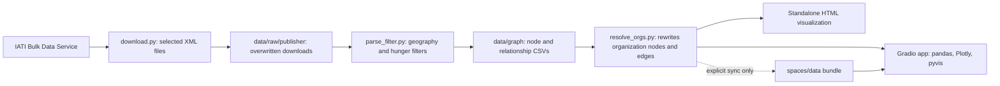

# Summer prototype review

Reviewed October 7, 2026. Local commit: `76546d3a2189e419c0233bfbf2093916f67ec4f7`.

The prototype is a useful feasibility baseline: it downloads a selected IATI slice, extracts entities and relationships, resolves some organization references, and serves CSV-based visualizations. The next priority should be trustworthy ingestion and analytical definitions. Automating the existing code unchanged would also automate its silent failures, overwrites, and ambiguous totals.

This review is an analysis, not an implementation of the fall deliverables. Existing application code and graph CSVs were left unchanged. Document instructions and meeting action items were treated as source material, not authorization to contact people or perform unrelated work.

## Evidence and limits

- Reviewed all seven Python source files, dependency manifests, documentation, fixtures, and all 22 graph CSVs.
- Read the supplied 19-page PDF and the [source Google Doc](https://docs.google.com/document/d/1ulXtTVfVU0o0iSl5nf1m8k_fx8a6V7opccLkDtUqawA/edit), including September 25 kickoff notes. The PDF was copied unchanged into the repository root.
- Read [Hugging Face metadata](https://huggingface.co/api/spaces/shinushibu1798/iati-graph-prototype). It reported commit `c6b70f342272d2a2d011c8a1d626a9e02d5eb96b`, last modified July 23, 2026, and runtime `RUNNING`. The upstream README, app, parser, and pipeline runner match the local files after line-ending normalization. This is a four-file comparison, not a claim that every upstream byte was compared.
- Ran isolated parser/resolver/download-failure probes and executed three existing app analytics functions on synthetic DataFrames. All seven source files passed Python syntax parsing. The seven supplied fixture records produced the expected four inclusions and three exclusions.
- Did not launch or visually test the live Gradio app, run a fresh bulk download, or reproduce the original 505-activity extraction from source XML: the raw publisher XML is absent. Gradio and pyvis are not installed locally. Public Space runtime metadata is not a functional UI test.
- Reproduction: `python analysis/audit_prototype.py` (requires pandas and plotly). Results: [audit_results.json](audit_results.json). All mutation probes use temporary directories; the inherited graph is not rewritten.

## Structure and data flow

| Component | What it does | Main limitation |
| --- | --- | --- |
| `fa26/src/config.py` | Three publisher slugs, 13 hotspot countries, hunger rules, paths | Fixed report period; rules duplicated in app; configured America organization reference differs from the actual node |
| `download.py` | Selects datasets by publisher and filename heuristic; downloads cached XML | No immutable snapshots, manifest, atomic replacement, or failure propagation |
| `parse_filter.py` | Parses XML, filters, deduplicates, writes 11 node and 11 relationship tables | First-seen duplicate policy; incomplete provenance and validation |
| `resolve_orgs.py` | Normalizes references, matches names, fills labels, applies aliases | Ambiguous name matches; mutates exports in place |
| `pipeline.py` | Runs subprocess stages; optional CSV sync | Default `all` and `refresh` omit the documented sync |
| `spaces/app.py` | Graph explorer, six canned questions, heatmap, Sankey, timeline | Global in-memory data loaded once; no natural-language retrieval or database |
| `visualize_html.py` | Produces standalone graph HTML | Uses a different graph view and broadly aggregates provider transactions |
| `tests/` | XML and dataset-index fixtures | No inherited executable assertions or test runner |
| Root/dataset documentation | Spark templates | Unfilled project README and dataset documentation |

`HAS_TRANSACTION` and `HAS_BUDGET` are conceptual relationships in the README. An importer must derive them from each child table's `iati_identifier`; separate edge CSVs are not supplied. The transaction edge table uses `PROVIDED_BY`, while the README diagram uses the inverse `PROVIDES`; a Neo4j loader must define directions explicitly.

## What the supplied snapshot actually contains

| Publisher | Activities | Inclusion basis | Timing observation |
| --- | ---: | --- | --- |
| Oxfam GB | 412 | All keyword matching | Actual starts span 2006–2026 |
| Oxfam America | 11 | All keyword matching | Actual starts in 2017–2018; record update timestamps in July 2020 |
| WFP | 82 | 75 sector, 7 keyword | Planned starts span 2018–2026; all retained record update timestamps July 6, 2026 |
| Total | 505 | 430 keyword / 75 sector | Different coverage windows; not a current-year activity census |

Additional observations from direct CSV profiling:

- 23,423 transactions, 2,999 budgets, 238 organizations, 82 locations, 13 countries, 17 sectors, and 2 SDG nodes.
- 85.1% of activities entered through keyword matching. Inclusion does not establish verified hunger relevance or comparable publisher coverage.
- 96 organization identifiers are name-based placeholders; 13 organization names remain blank.
- 3,457 participation rows contain 210 exact duplicates. The app's participation counts therefore need deduplication before interpretation.
- 5,337 transaction values are negative. Their signs alone do not establish errors; corrections/reversals require a policy.
- Transactions are GBP (9,581 rows) or USD (13,842). All transaction-level country fields are blank, and every retained activity has one hotspot country.
- WFP has 8,310 incoming-fund, 2,756 commitment, and 2,756 expenditure rows, but no type-3 disbursement rows. Oxfam America has only 20 expenditure rows. This affects which publishers appear in the current Sankey.
- All 505 activities have budgets, but only 20 budget rows are marked committed, all with original type. The other 2,979 rows are revised and indicative. An empty committed-budget comparison does not mean a publisher has no budget.
- Emergency, policy-marker, region, and related-activity tables are empty. Results and indicators are not extracted at all. Empty exports do not prove the original sources have no such information.
- Existing organization relationship endpoints resolve, and existing country edges have matching country nodes. The non-hotspot endpoint defect below is demonstrated by a fixture, not present in this snapshot.

## Findings requiring attention

**F1 — High: failed or incomplete ingestion can replace good data. Confirmed with isolated probes.**

`download.py:83` catches individual download exceptions and returns normally. `parse_filter.py:436` warns when raw folders are absent, then writes its output tables anyway (`:459`). A simulated missing-input run overwrote a populated temporary graph with zero activities. Malformed XML can also leave records processed before the error in the output. A one-publisher run or `--no-theme` coverage scan writes into the same graph directory as the full production run. No atomic promotion or quality gate protects the last successful dataset.

Fix direction: stage each run separately; require publisher completeness and validation checks before publishing; retain a last-good snapshot and explicit failure status. Client decision: whether partial publisher refreshes are ever acceptable and how stale data should be labeled.

**F2 — High: historical change tracking is absent. Confirmed design gap.**

Downloads overwrite stable filenames (`download.py:119` onward), graph exports are overwritten, and resolver `.bak` files are replaced on each write. These are not a historical archive. `last_updated` captures a publisher timestamp, not when the system observed a record. There is no saved index, source hash, run identifier, or raw-file-to-row lineage.

The September 25 notes explicitly ask to preserve changing data (PDF p.16), while the formal brief emphasizes a daily refresh (pp.3–5). Those requirements need a shared definition. Transaction dates answer when funding was reported to occur; snapshots answer what was published as of a date. The system needs both if historical comparison is intended.

**F3 — High: duplicate handling can choose an obsolete record or discard a valid one. Confirmed with synthetic XML.**

`parse_filter.py:299–306` marks an identifier seen before geography/theme checks and retains the first occurrence in sorted file order. A newer duplicate lost to an older record in the probe. A non-hotspot first occurrence blocked an otherwise eligible later duplicate. The stored coverage report says 22 duplicates were dropped, but does not identify them or explain disagreements. Select a documented winner and preserve conflicting versions/provenance; do not blindly equate every duplicate with an error.

**F4 — High: the general-emergency toggle does not work. Confirmed.**

`config.py` already includes `72010` in `HUNGER_DAC_CODES`; `parse_filter.py:33` unions that set with either another `72010` or an empty set. Consequently `is_hunger_sector('72010','1')` is true even when `INCLUDE_GENERAL_EMERGENCY=False`. The coverage report records the false flag, creating misleading evidence about the active filter. No retained activity-level 72010 sector was found in this snapshot, so the actual historical impact cannot be quantified without raw XML. Client decision: should broad material relief qualify as hunger-related?

**F5 — High: “funding” views have incompatible transaction definitions. Confirmed code behavior; current and future-data impacts differ.**

`q_top_funders` (`app.py:188`) aggregates every transaction type that has a provider edge. Current Oxfam GB inputs include incoming funds, commitments, disbursements, and expenditure in that calculation. The standalone HTML funding edges do the same. The Sankey (`:264`) treats both type 1 and type 11 as incoming funds, although type 11 is an incoming commitment. A synthetic 100 received + 100 committed gives a 200 incoming link. No type-11 transactions exist in the supplied snapshot. The timeline (`:310`) adds disbursements and expenditure, with a label acknowledging both, but users still need to understand that this is not automatically unique aid delivered. These distinctions follow the [IATI transaction-type definitions](https://iatistandard.org/en/iati-standard/203/codelists/transactiontype/).

The Sankey's outgoing side accepts only type 3, so it cannot show WFP or Oxfam America expenditure as downstream activity. It also takes only the top 14 incoming and outgoing groups independently without an “other” total. A receiver is labeled an implementing partner without checking its role. Thus the visualization is a partial aggregation, not a reconciled, transaction-linked delivery chain. Separate measures and disclose missing counterparties, exclusions, and adjustments.

**F6 — High before scope expansion: country allocation ignores transaction geography and percentages. Reproduced on synthetic data.**

Both funder and Sankey functions select activities by hotspot membership and then include all transactions from those activities. A transaction explicitly assigned to Yemen appeared in a synthetic South Sudan query. An activity spanning two countries could have its entire funding counted in both. Current exports have no multi-hotspot activities or populated transaction-country fields, so this specific over-allocation is latent in the supplied snapshot. Agree a hierarchy for transaction geography, activity percentages, and unknown allocations.

**F7 — High for Graph RAG/history: identifiers and source relationships are discarded. Confirmed.**

`parse_filter.py:183` creates transaction IDs from XML position (`#tx0`, etc.), ignoring source transaction `@ref`; locations and budgets also use positional identifiers. Insertion or reordering can change the identity associated with a graph key. Provider/receiver activity identifiers are not retained. The [IATI provider-org reference](https://iatistandard.org/en/iati-standard/203/activity-standard/iati-activities/iati-activity/transaction/provider-org/) documents the provider activity linkage. The parser also lacks dataset URL/hash, source XML location, and record-level cleaning history.

The brief's WFP country-code-in-reference example cannot be confirmed from the available exports. In particular, the relevant activity-reference attributes may already have been discarded. Request the exact XML example and expected interpretation before writing a WFP-specific correction. Preserve raw values and distinguish invalid identifiers from unresolved external references.

**F8 — Medium/high: organization resolution can silently choose an ambiguous identity. Reproduced.**

`resolve_orgs.py:182` maps each normalized name to one real reference; repeated names overwrite earlier candidates. A synthetic name-only “Shared Charity” merged into the last of two equally named organizations. `norm_name` removes non-ASCII characters and common words, increasing ambiguity for multilingual data. The parser's `setdefault` also loses later, richer labels for a reference before resolution. The resolver advertises merging name-only variants with one another but has no separate pass for that behavior.

Manual aliases and DAC-recipient fallback labels need client/domain review. The configured Oxfam America ref is `US-EIN-237069110`, but the exported node is `US-EIN-23-7069110`; configuration currently does not reconcile these. Preserve aliases, competing candidates, confidence, and review decisions. Deduplicate rewritten edges: the current snapshot has 210 repeated participation rows.

**F9 — Medium: graph completeness and inference depend on which path is used. Fixture-confirmed.**

`parse_filter.py:349` exports every activity country edge but `:475` creates country nodes only for hotspots. The supplied test fixture includes Sudan plus Chad and produces a dangling Chad edge. Transaction-only geography can qualify an activity (`:248`) without generating an activity-country edge from that transaction. The UI draws country connections from a derived `hotspot_countries` string, so it can show a connection missing from an importer that uses only the relationship CSV. Decide whether to retain out-of-scope endpoint nodes and whether inferred links need their own type/provenance.

**F10 — Medium: original and revised budgets can be added together. Reproduced on synthetic data.**

`q_budgets` (`app.py:214`) selects committed status, then sums without resolving budget type or overlapping periods. A 100 original budget and 150 revision produced 250. The current committed subset contains only original budgets, so the demonstrated revision double count is not established in this snapshot. The [IATI budget specification](https://iatistandard.org/en/iati-standard/203/activity-standard/iati-activities/iati-activity/budget/) distinguishes revisions from originals. Agree how to select applicable revisions and allocate periods that cross years.

**F11 — Medium: filtering introduces unmeasured relevance and coverage bias. Confirmed rules; accuracy unmeasured.**

`KW_RE` (`parse_filter.py:32`) has no word boundaries: “Flipchart training” matches `IPC`. Descriptions are truncated to 2,000 characters before keyword matching; only the first narrative per element is read. Current matching falls back for custom/unspecified vocabularies, contrary to README language saying only records with no sector coding qualify. Transaction-level sectors can trigger inclusion but do not become sector graph edges. Filename-based download selection can exclude a relevant regional dataset unless manually whitelisted. Validate against a small client-reviewed sample and expose match reasons and unknown coverage.

**F12 — Medium: the documented refresh can leave the app on old data. Confirmed by code inspection.**

README promises `all`/`refresh` will sync. `pipeline.py:36` and `:66` omit sync from those stage lists. Once `spaces/data/nodes_activities.csv` exists, `_find_data` (`app.py:30`) prefers the bundled data, even on local runs. Global DataFrames load only at app startup. Therefore pipeline refresh alone does not guarantee fresh charts. There is currently no bundled `spaces/data` directory in this checkout, so the immediate local fallback points at `data/graph`. Publish one versioned dataset and expose its version/freshness in the UI.

## Brief, implementation, and handoff inconsistencies

| Source expectation | Observed implementation | Clarification |
| --- | --- | --- |
| Summer description promises source click-through | No source URL field or source-navigation handler in the reviewed graph code; publisher text is in tooltips | Obtain a demonstrated example or confirm this feature still needs implementing |
| Explorer described as including locations | Gradio graph renders countries, organizations, activities, and optional sectors; it does not load location nodes | Does “location” mean countries or actual subnational locations? |
| Neo4j and Graph RAG fall deliverables | No loader, constraints, Cypher scripts, scheduler, LLM call, retrieval layer, or evaluation suite | Planned fall work, not a summer defect; agree minimum deliverables |
| Documented data-quality examples | Aggregate coverage/resolution JSON exists; no record-level issue catalog or raw examples supplied | Request original anomaly examples and cleaning rationale |
| Reproducible handoff | No raw snapshots/run manifest; non-Gradio dependencies unpinned; fixtures without assertions | Pin a baseline and store run inputs and reproducible commands |
| License metadata says MIT | Root `LICENSE` contains GPLv3 | Ask maintainers which license applies to imported and fall code; do not infer legal compatibility |
| README says IATI 2.0x only | Parser contains selected 1.x vocabulary/type compatibility; fixture mixes legacy values | State supported versions and validate each explicitly |
| Kickoff summary uses “IoT” | Formal scope and source code consistently concern IATI | Likely recap/transcription error; correct the project record rather than expand scope |

The graph model is reasonably broad for a prototype, but output rows and relationships accumulate in Python memory, and downloads call `r.read()` for the full response. Streaming XML alone does not make the complete workflow suitable for the full corpus. Broader-corpus scale should be measured separately; the brief explicitly does not require cleaning all IATI.

## Suggested order of work

1. Agree history, funding definitions, hunger/geographic scope, and acceptance questions with the client. Use [CLIENT_QUESTIONS.md](CLIENT_QUESTIONS.md) for the meeting.
2. Preserve immutable raw inputs and a manifest; make failed runs safe; fix filtering, duplicate selection, source identifiers, and provenance. Turn the demonstrated defects into regression checks during implementation.
3. Add graph integrity checks and an issue catalog; validate sample totals and entity mappings with domain reviewers before presenting organization comparisons.
4. Load a validated snapshot into Neo4j with explicit keys, constraints, edge directions, and repeatable update/deletion rules. Then schedule refreshes with rollback and freshness visibility.
5. Build Graph RAG around approved questions and verified queries, returning source records, snapshot date, and uncertainty. Treat broader-corpus ingestion and model comparisons as scope decisions after the foundation is reliable.

Proposed acceptance examples: a failed download leaves the last-good graph intact; re-running an unchanged snapshot makes no logical changes; every edge resolves or is explicitly classified as unresolved; a historical answer identifies its snapshot; each funding result exposes transaction type, currency, period, and allocation rule; an unsupported question produces an explicit limitation rather than an invented answer. These are recommendations for client agreement, not already-approved requirements.
